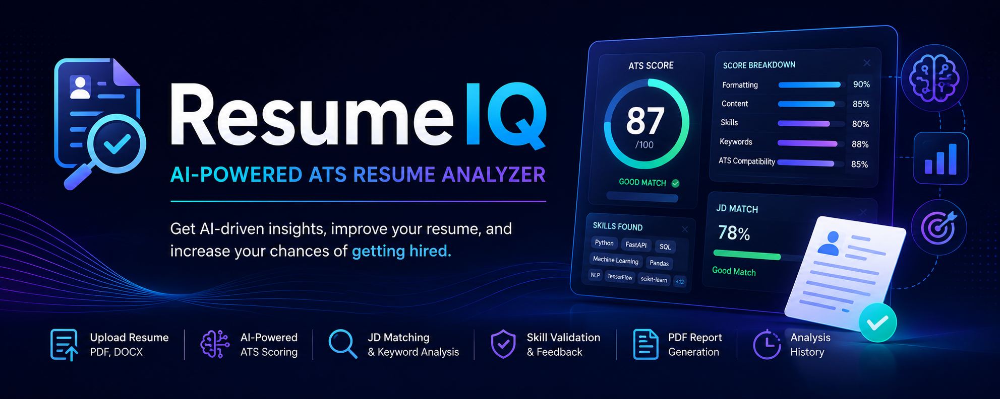
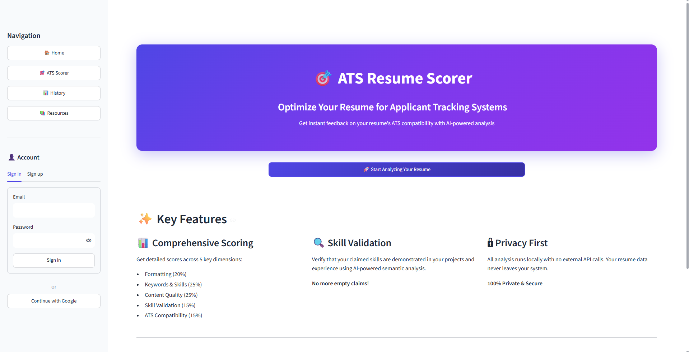
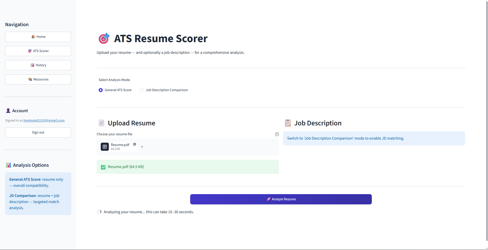
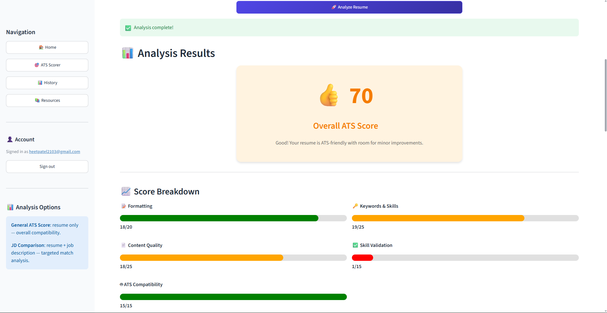
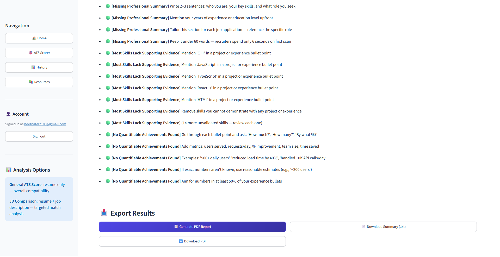
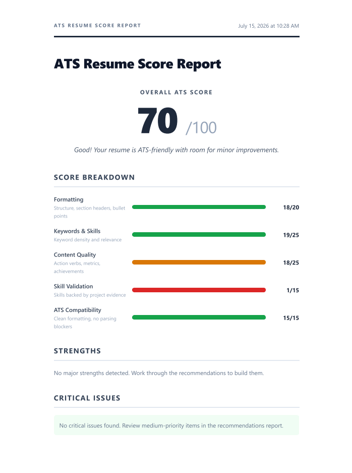
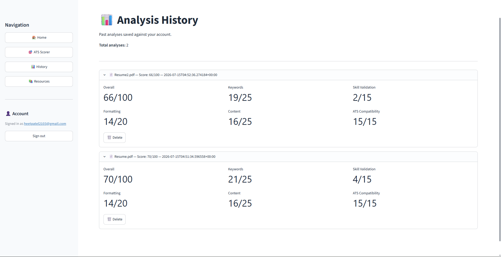

<p align="center">
  
</p>

<h1 align="center">🚀 ResumeIQ – AI-Powered ATS Resume Analyzer</h1>

<p align="center">
  <strong>Analyze • Optimize • Get Hired</strong>
</p>

<p align="center">
An AI-powered ATS Resume Analyzer that evaluates resumes using modern NLP and LLM techniques, provides recruiter-style feedback, validates skills, compares resumes with job descriptions, and generates professional PDF reports.
</p>

<p align="center">


</p>

---

# ✨ Features

- 📄 Resume Upload (PDF & DOCX)
- 🤖 AI-powered ATS Resume Scoring
- 📊 Component-wise Score Breakdown
- 🎯 Job Description Matching
- 🧠 Skill Validation using Semantic Similarity
- 📑 Detailed Recruiter-style Feedback
- ✅ ATS Compatibility Analysis
- 📈 Resume Improvement Recommendations
- 📄 Professional PDF Report Generation
- 📥 Download Analysis Summary (.txt)
- 🔐 Secure Authentication using Supabase
- 🕒 Resume Analysis History

---

# 📸 Application Screenshots

## 🏠 Home Page

<p align="center">

</p>

---

## 📄 Resume Upload

<p align="center">

</p>

---

## 📊 ATS Analysis Results

<p align="center">

</p>

---

## 📋 Recommendations & Export

<p align="center">

</p>

---

## 📑 Generated PDF Report

<p align="center">

</p>

---

## 🕒 Analysis History

<p align="center">

</p>

---

# 🏗️ Tech Stack

## Backend

- FastAPI
- Python
- spaCy
- Sentence Transformers
- Groq LLM API
- WeasyPrint
- PyPDF2
- pdfplumber
- python-docx

## Frontend

- Streamlit
- Plotly
- Pandas

## Database & Authentication

- Supabase Authentication
- Supabase PostgreSQL

## AI / NLP

- spaCy
- Sentence Transformers
- Semantic Similarity
- Resume Parsing
- Keyword Matching
- Skill Validation

---

# 📂 Project Structure

```text
ResumeIQ/
│
├── assets/
│   ├── banner.png
│   ├── home.png
│   ├── upload.png
│   ├── results.png
│   ├── recommendations.png
│   ├── pdf-report.png
│   └── history.png
│
├── backend/
│   ├── api/
│   ├── core/
│   ├── database/
│   ├── models/
│   ├── services/
│   ├── templates/
│   ├── utils/
│   └── main.py
│
├── frontend/
│   ├── components/
│   ├── services/
│   ├── views/
│   └── streamlit_app.py
│
├── jupyter notebooks/
├── .env.example
├── .gitignore
├── requirements.txt
└── README.md
```

---

# 🚀 Getting Started

## 1. Clone Repository

```bash
git clone https://github.com/YOUR_USERNAME/ResumeIQ.git

cd ResumeIQ
```

---

## 2. Create Virtual Environment

Windows

```bash
python -m venv .venv

.venv\Scripts\activate
```

Linux / macOS

```bash
python3 -m venv .venv

source .venv/bin/activate
```

---

## 3. Install Dependencies

```bash
pip install -r requirements.txt
```

---

## 4. Configure Environment Variables

Create a `.env` file using `.env.example`.

Example:

```env
GROQ_API_KEY=your_groq_api_key

SUPABASE_URL=your_supabase_url

SUPABASE_ANON_KEY=your_supabase_anon_key

SUPABASE_KEY=your_supabase_service_role_key

SENTENCE_TRANSFORMER_MODEL=all-MiniLM-L6-v2

AUTH_REDIRECT_URL=http://localhost:8501
```

---

## 5. Run Backend

```bash
uvicorn backend.main:app --reload
```

Swagger Documentation

```
http://127.0.0.1:8000/docs
```

---

## 6. Run Frontend

```bash
streamlit run frontend/streamlit_app.py
```

Open

```
http://localhost:8501
```

---

# 📊 ATS Analysis Includes

- Overall ATS Score
- Resume Formatting Analysis
- Keyword Matching
- Content Quality
- Skill Validation
- ATS Compatibility
- Recruiter Feedback
- Recommendations
- Action Items
- Missing Keywords
- JD Match Analysis
- Semantic Similarity

---

# 📄 Export Features

- Professional PDF Report
- Download Summary (.txt)
- Resume Analysis History

---

# 🔐 Authentication

ResumeIQ uses **Supabase Authentication** for:

- Email Login
- Google Login
- JWT Authentication
- Protected FastAPI APIs
- User-specific Analysis History

---

# 🎯 Future Improvements

- Resume Rewrite using AI
- Multi-language Resume Support
- Resume Version Comparison
- Cover Letter Generator
- Interview Question Generator
- Resume Templates
- Admin Dashboard

---

# 👨‍💻 Author

**Heet Patel**

- GitHub: https://github.com/heet88
- LinkedIn: https://www.linkedin.com/in/heet247

---

# ⭐ Support

If you found this project useful, consider giving it a ⭐ on GitHub.

It helps others discover the project and motivates future improvements.
